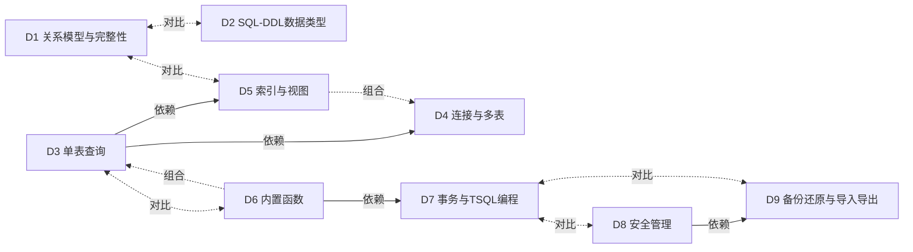

# 蒸馏-数据库 · 九单元总索引（D1–D9）

素材口径：
- 章节覆盖、核心钩子取自各单元 SKILL.md 头部元信息与 I 区（钩子区）。
- 题库量 = 各单元 test-prompts.json 全部条目数，**含标记"不该触发/不该出"的诱饵题**（D1–D6、D8、D9 各 3 条 + 边界题 1 条；D7 为 2 条诱饵 + 1 条边界题）。
- 盲测通过率来自三份阶段4验收报告：D1–D4 报告以 should_trigger 口径给率（诱饵、边界题亦全过）；D5–D9 报告按 should_trigger + decoy + edge 全口径合计。

## 一、单元总览表

| 单元 | 章节覆盖 | 核心钩子（摘自 SKILL.md I 区） | 题库量 | 盲测通过率 |
|---|---|---|---|---|
| D1 关系模型与完整性 | ch01 + ch07 | ① 四类完整性 = "行、格、表、人"：实体管行（行行有身份证）、域管格（格格有门槛）、参照管表间（表表有户口）、用户定义管人；② 六约束对号入座："主键锁行，UNIQUE 锁列放空行，CHECK 划红线，DEFAULT 填空位，NOT NULL 堵空洞，外键认亲戚" | 11 | 100%（7/7，诱饵 3/3、边界 1/1 均过） |
| D2 SQL-DDL数据类型 | ch03 + ch04 | ① 类型选型四判据——定变？中英？大小？算不算？（不做算术的数字串永远选 char）；② 页 8KB、行 8060B；mdf/ndf/ldf = 主、次、账本 | 10 | 100%（6/6，诱饵 3/3、边界 1/1 均过） |
| D3 单表查询 | ch05 | ① 执行流水线 "W-G-H-S-O"：WHERE 过滤行、GROUP 切组、HAVING 卡阻——三层筛子越筛越细；② "IS NULL 是唯一门禁，等号进不去 NULL 的门" | 12 | 100%（8/8，诱饵 3/3、边界 1/1 均过） |
| D4 连接与多表 | ch05 连接节 + ch12 | ① 外连接 = 保留没配上的行、缺的那侧补 NULL，方向只看 JOIN 左边是谁；② ODBC 四层 = 说话的→派活的→干活的→存货的 | 10 | 100%（6/6，诱饵 3/3、边界 1/1 均过） |
| D5 索引与视图 | ch06 | ① 索引 = 书的目录，视图 = 窗户（虚实、单向、可多开）；② 聚集索引 = 书柜里书已按索书号排好，非聚集 = 贴在柜门上的卡片索引 | 10 | 100%（10/10 全口径） |
| D6 内置函数 | ch08 | 记忆锚："聚合怕 NULL，字符串怕空格，日期分 int/串，转换怕失败（TRY_CONVERT 兜底 NULL）" | 12 | 100%（12/12 全口径） |
| D7 事务与TSQL编程 | ch09 + ch10 | ① ACID 四钩：全做或全不做 / 账目不坏 / 排队不串 / 停电不丢；② 存储过程 = 请饭（EXEC 点名才上菜），触发器 = 保安（自动拦、不点名、不带参） | 11 | 90.9%（10/11，fail：D7-06） |
| D8 安全管理 | ch11 §11.1–11.3 | ① 两级门禁：登录名 = 大门钥匙、数据库用户 = 房间通行证、权限 = 房间里能碰哪张桌子；② GRANT 记存入、REVOKE 划掉、DENY 盖冻结章——DENY 一票否决 | 10 | 100%（10/10 全口径） |
| D9 备份还原与导入导出 | ch11 §11.4–11.9 | ① 摄影四兄弟：完整 = 全家福、差异 = 只拍新来的、日志 = 监控录像、文件组 = 按房间拍；② 放映铁律：还原必须从全家福开始放，崩溃瞬间先抢最后一段监控（活动日志尾） | 11 | 90.9%（10/11，fail：D9-ST5） |

**合计：总题库量 97 条；D7 与 D9 并列通过率最差（各 10/11 ≈ 90.9%）。**
两处 fail 均为标准答案层错误、题干无错：D7-06（教材"ROLLBACK 后 @@TRANCOUNT 减 1"与真机"归 0"冲突）、D9-ST5（完整备份日期误写"上周五 2月26日"，应为 3月4日）。

## 二、单元引用图

三类边清单（对应上文图内注释）：

- **依赖**（4 条）：D3→D4（出现第二个表名/JOIN 即移交 D4，多表建立在单表五子句上）；D3→D5（视图 = 存起来的 SELECT 定义）；D6→D7（D7 明示"前置 D6"，函数语法归 D6）；D8→D9（D9 由 D8 边界淘汰内容补位收编，同属 ch11）。
- **对比**（5 条）：D1↔D2（主键/外键/CHECK——语义归类 vs DDL 语法书写）；D1↔D5（PRIMARY KEY/UNIQUE 约束 vs 约束自动生成的唯一索引）；D3↔D6（"查的骨架问 D3，函数返回值问 D6"）；D7↔D8（ROLLBACK 撤销本次改动 vs REVOKE 收回长期资格——操作不坏 vs 人不配看）；D7↔D9（两个"事务日志"不是一回事——机制本体 vs 被备份对象）。
- **组合**（2 条）：D6→D3（聚合/字符串函数嵌进 SELECT/HAVING/表达式列连用）；D5→D4（多表连接视图 = CREATE VIEW × INNER JOIN 连用）。

补充说明：D6 与自写（用户定义）函数的分界也落在 D6–D7 一线上——内置函数不能修改，用户定义函数语法归 D7；该分界已并入 D6→D7 依赖边的口径，不另画边。
