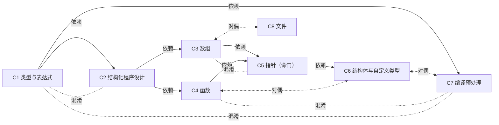

# 蒸馏-高级语言 · 八单元总索引（C1–C8）

素材口径：
- 章节覆盖、最强钩子取自各单元 SKILL.md 头部元信息与 I 区（钩子区）。
- 题库量 = 各单元 test-prompts.json 全部条目数，**含标记"不该触发/不该出"的诱饵题**（各单元均为 3 条诱饵 + 1 条边界题；单元名标注"压轴"意为是）。
- 盲测通过率来自三份阶段 4 验收报告：C1 按 过11+半过1/12 计 95.8%（严格口径 91.7%）；C7 按 过/全口径 11/13 计 84.6%；其余单元全口径。
- **特别标注：C5 指针是全书命门单元（SKILL.md 219 行、10 trigger、三胞胎三值分离是收口考），篇幅与题量最大。**

## 一、单元总览表

| 单元 | 章节覆盖 | 最强钩子（摘自 SKILL.md I 区，择 1-2 条） | 题库量 | 盲测通过率 |
|---|---|---|---|---|
| C1 类型与表达式 | ch01 + ch02 + ch03 | ① 整型四兄弟长度表："char 1 < short 2 < int 4 = long 4 < double 8，float 4 站中间"（题干给 16 位 PC 必须换挡 int=2）；② 求值五步法 + "++i 钉前先加后用、i++ 钉后先用后加，双副作用按教材顺序口径判停" | 12 | 95.8%（11.5/12；严格 11/12，fail 点=例3-37/39 缺 int 字节双口径，已补丁） |
| C2 结构化程序设计 | ch04（部分并 ch01 骨架） | ① else 就近配对——想改判，加花括号；② switch 不加 break 是穿堂风；表格跟踪法（行高=内层层数）照搬即得 | 13 | 100%（13/13） |
| C3 数组 | ch05 | ① 下标从 0 数，a[n] 永踩界——未初始化是垃圾值不是 0；② 字符串有尾巴 `\0`：strlen 不含尾巴、sizeof 数定义长 | 11 | 90.9%（10/11，D2 输出串笔误已回炉为 `#*#**#`） |
| C4 函数 | ch06 | ① 传值=复印件随便涂，传址=房钥匙改得了真房；② static 局部=复读机只念第一遍；return 是单程票 | 12 | 91.7%（11/12，T8 标答算数错已改 11 21 31） |
| **C5 指针（命门）** | **ch07** | ① 变量住地址、指针存门牌——`&` 查门牌、`*` 按门牌进门，`*p` 进屋改家具、`p` 只是换门牌；② 三胞胎判据：`*p++` 取完搬家/`(*p)++` 屋里加一/`*++p` 先搬再取；指针题三问：指向谁？解引用了吗？移了几步？ | 14 | 100%（14/14，三胞胎三值分离全程无搅线） |
| C6 结构体与自定义类型 | ch08 | ① 结构体=不同类型打包：`.` 走变量、`->` 走地址；② typedef 是发别名不是造新人；整体赋值合法、整体比较非法（能抄不能比） | 10 | 100%（10/10） |
| C7 编译预处理 | ch09 | ① 宏=文本代打，没括号就是裸奔（形参+整体双括号铁律、宏名与左括号间不留空格）；② 宏计算三步法：找目标→先替换后运算→套 C1 优先级 | 13 | 84.6%（11/13；T7 缺选项文本、D3 归属歧义，两处轻修不阻塞） |
| C8 文件 | ch10 | ① 读写对偶表——会一个等于会两个（fgetc↔fputc / fgets↔fputs / fread↔fwrite / fscanf↔fprintf）；② 六模式口诀"读 r 写 w 添 a 追加，加 + 能读写，加 b 变二进制"；fseek 头 0 腹 1 尾 2 | 11 | 100%（11/11） |

**合计：总题库量 96 条**（逐行相加：12+13+11+12+14+10+13+11 = 96；其中 should_trigger 63 条 = C1 8 + C2 9 + C3 7 + C4 8 + C5 10 + C6 6 + C7 8 + C8 7，诱饵 24 条 = 各单元 3 条，边界 8 条 = 各单元 1 条）。
**最低分 C7（84.6%）与 fail 都不在知识层**：两处是题面精修（选项文本、归属表述），一处是标答算数——五处补丁已全部按验收报告清账；两处 fail（C3-D2 输出串、C4-T8 答案）均为标准答案层错误、题面无错。

## 二、单元引用图

三类边清单（对应上文图内注释，从各 SKILL.md 混淆表提炼）：

- **依赖**（7 条）：C1→C2（循环条件就是一个表达式求值，`while(i=0)` 是赋值不是比较）；C2→C3（数组遍历/排序骨架=三循环）；C2→C4（函数体=控制流搭成，递归出口≈判停条件）；C3→C5（数组名=首地址常量这条铺垫，到 C5 才展开成指针运算与四等价）；C4→C5（值传递改不动实参，swap 是"传地址"的唯一通行证）；C5→C6（`p->成员`/`(*p).成员` 建立在指针本体之上）；C1→C7（宏替换完成后的表达式仍按 C1 优先级天梯求值）。
- **对偶**（3 条）：C3↔C8（gets 从键盘 vs fgets 从文件——回车一个换 `\0`、一个保留 `\n` 再补 `\0`）；C4↔C6（传整个结构体=复制折不丁点，传 `&arg` 才真改——值址传递的结构体版）；C6↔C7（typedef 编译时发别名 vs #define 预处理时文本代打）。
- **混淆**（4 条）：C1↔C2（`=` 的值归 C1、"循环走不走路"归 C2）；C3↔C5（数组名偏移 vs 指针算术，`a++` 非法 `p++` 合法）；C4↔C7（MAX 函数：实参先求值一次；MAX 有参宏：文本代打可能重复求值）；C1↔C7（对象宏纯替换无陷阱归 C1 接手求值，有少括号/重复求值陷阱才是 C7 主场）。

上下册口径校准：C5 的三胞胎、swap 三兄弟既是"命门考"，也是 C3/C4/C6 三条混淆边的中枢——若时间只够精读一个单元，读 C5。
